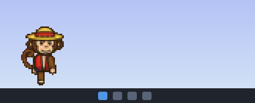
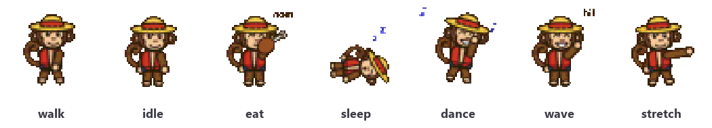

# Screen Buddy

A tiny animated pet that lives at the bottom of your screen. He walks, naps, eats, dances, and complains when you pick him up.

This was a lazy Friday night project I decided to do. Mine is a straw-hat-wearing Luffy fan pet. The repo ships with an original pixel-art monkey so it works out of the box, and you can drop in any sprites you like to make your own buddy.





## Download (no coding needed)

1. Go to the [latest release](https://github.com/JulianChaoul16/Screen_Buddy-/releases/latest).
2. Download **ScreenBuddy.exe**.
3. Double-click it. Your buddy appears at the bottom of your screen, and a small icon appears in the system tray near the clock.

The first launch can take a few seconds. To have him start every time you turn on your PC, right-click the tray icon and tick **Start with Windows**. To close him, right-click the tray icon and choose **Quit**.

> **"Windows protected your PC"?** That warning appears for apps from small developers that aren't code-signed. Click **More info**, then **Run anyway**. If you'd rather not, you can run it from source using the steps below.

The download comes with the default monkey. To use your own sprites, run it from source (below).

## Features

- **Lives on your desktop.** He's a frameless, always-on-top window that walks along the taskbar and turns around at the screen edges.
- **Has a routine.** He picks a random activity from walk, idle, eat, sleep, dance, wave and stretch. He spends most of his time napping.
- **Drag and drop.** Pick him up and he flails. Let go and he falls, faceplants, then gets back up.
- **Click to pause.** A single click freezes him, and another click resumes.
- **System tray.** Left-click the tray icon to show or hide him. Right-click it for the controls: activities, Pause, Show/Hide, Start with Windows, and Quit.
- **Starts with Windows.** One checkbox in the tray menu, with no console window.
- **Bring your own sprites.** Any folder of PNG frames works, and a helper script can cut up a sprite sheet for you.

## Run from source

You need Python 3.10 or newer. The tray and autostart features are Windows-only; the pet itself should run anywhere PySide6 does.

```bash
git clone https://github.com/JulianChaoul16/Screen_Buddy-.git
cd Screen_Buddy-
python -m venv .venv
.venv\Scripts\activate
pip install -r requirements.txt
python main.py
```

To have him launch on his own, right-click the tray icon and tick **Start with Windows**. That adds a shortcut to your Startup folder, and unticking it removes the shortcut. If you move the project folder, untick and re-tick it so the shortcut points at the new location.

## Controls

| Action | What happens |
|---|---|
| Click him | Pause or resume |
| Click and drag him | Carry him around, then drop him to watch him fall |
| Right-click him | Activity menu and controls |
| Left-click the tray icon | Show or hide him |
| Right-click the tray icon | Activity menu and controls, including Start with Windows and Quit |

## Make your own buddy

The pet plays whatever PNG frames it finds in `assets/<activity>/`, in filename order:

```
assets/
  walk/   01.png 02.png ...   <- required
  idle/   ...
  sleep/  ...
  eat/ dance/ wave/ stretch/
  carry/  ...                 <- while being dragged or falling
  land/   ...                 <- plays once after a drop
```

Sprite rules:
- **Facing right.** The app mirrors the frames for walking left.
- **Same canvas size for every frame,** with the feet on the bottom edge.
- **Transparent background.**
- **Only `walk` is required.** Activities without a folder are skipped.

To use a custom pack, put it in `assets/<pack-name>/`. `main.py` loads `assets/luffy/` when it exists and the default monkey otherwise; change that one `if` near the top of `main.py` to use a different name. Packs in `assets/luffy/` are gitignored by default, so add your pack's folder to `.gitignore` too if you don't want it published.

### From a sprite sheet

`slice_sheet.py` finds every sprite on a sheet automatically and exports the frames you choose.

1. Save your sheet as `assets/luffy/luffy_sheet.png`, or change `PACK` and `SHEET` at the top of the script.
2. Run `python slice_sheet.py --preview`. This writes `_preview.png` with every row and sprite numbered.
3. Edit `PICKS` in `slice_sheet.py` to map activities to row and sprite numbers, for example `"walk": (1, [0, 1, 2, 3, 4, 5])`.
4. Run `python slice_sheet.py`.

The script also has these settings at the top:
- `SCALE` sets how many screen pixels each sprite pixel uses. `1` keeps it small, `2` doubles it.
- `FLIP = True` mirrors left-facing sheets.

### The default monkey

`make_sprites.py` draws the bundled pixel-art monkey with plain QPainter code, so no image files are needed. Tweak the colours or poses and re-run it to regenerate `assets/<activity>/frame_*.png`.

## Tweaking behavior

Everything lives in two tables at the top of `main.py`:

- `ACTIVITIES` sets the milliseconds per frame, how long each activity lasts, and whether he moves during it.
- `WEIGHTS` sets how often each activity is picked. For example, lower `sleep` if he naps too much. `0` means an activity is never picked at random.

## Project layout

| File | Purpose |
|---|---|
| `main.py` | The pet: animation, behavior, dragging, tray icon, autostart |
| `make_sprites.py` | Generates the default pixel-art monkey |
| `slice_sheet.py` | Cuts a sprite sheet into activity folders |
| `assets/` | Sprite frames |
| `docs/` | README images |
| `.github/workflows/release.yml` | Builds `ScreenBuddy.exe` for each release |

## Making a release

Tag a version and push the tag:

```bash
git tag v1.0
git push origin v1.0
```

GitHub Actions then builds `ScreenBuddy.exe` with PyInstaller and attaches it to a new Release. Only files committed to the repo get bundled, and the build refuses to run if `assets/luffy/` is present.

## A note on sprites and copyright

The code and the bundled monkey sprites are MIT licensed (see below). **Sprites of existing characters are not included and are not covered by this license.** Characters like Luffy belong to their creators. If you use art you didn't make, keep it for personal use, or use packs whose license allows sharing, and don't commit it to a public repo.

## Contributing

Issues and pull requests are welcome, whether new activities, macOS/Linux autostart, multi-monitor support, or anything else that makes your buddy better company.

## License

[MIT](LICENSE) © 2026 Julian Chaoul
